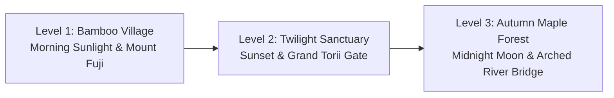

# Shinobi Sprint: Cinematic Unified-Plate Architecture & Handover Report

**Status**: ✅ All 3 Canonical Stages Successfully Standardized  
**Target Viewport**: Fixed 16:9 (`1024 x 576`)  
**Flutter Engine**: Flame 1.18.0 with `FixedResolutionViewport`  
**Test Suite**: 11/11 Tests Passing (`flutter test test/bamboo_village_test.dart`)  
**Static Analysis**: 0 Issues (`flutter analyze lib/bamboo_village`)  
**Interactive Previews**: Standalone zero-dependency HTML canvas previews with live hitbox/orb editor

---

## 1. Executive Summary & Architectural Paradigm

### The Problem Solved
Previously, attempts to slice hand-painted panoramic concept scenes into modular sprite tiles (cutout backgrounds, isolated sky, floating bridge props, detached Torii gates, and rectangular collision blocks) produced visual dissonance:
- **"Sticker Effect"**: Sprites lacked ambient occlusion, contextual ground shadows, and environmental lighting integration.
- **Detached Geometry**: Torii gates floated with cut-off pillars, and artificial dark bamboo bars obstructed the camera.
- **Visual Inconsistency**: Individual props conflicted with the perspective lines and atmospheric haze of the backdrop.

### The Solution: Cinematic Unified-Plate Architecture
As utilized by industry benchmarks (*Ori and the Blind Forest*, *Rayman Legends*, *Hollow Knight*):
1. **Unified Visual Stage Plate (Priority 0)**: The complete, hand-painted panoramic landscape serves as the master visual world plate. All atmospheric depth, lighting gradients, shadows, and architectural details remain intact.
2. **Invisible Collision Topology (Priority 3)**: Lightweight, invisible collision primitives (`GroundBlockComponent`, one-way drop-through `PlatformComponent`, slope ramps) are mathematically mapped along the hand-painted walkable terrain surfaces.
3. **Dedicated Dynamic Entities (Priority 4 & 5)**: Sprites are reserved **exclusively** for dynamic, interactive elements:
   - Chibi Blue Ninja Player (`character_ninja.png`)
   - Collectible Golden Spirit Orbs (`prop_spirit_orb_clean.png`)
   - Spinning Shurikens & Hazards (`prop_ninja_shuriken.png`, `hazard_bamboo_spikes.png`)
   - Floating Ambient Particle Emitters (Pollen, embers, falling maple leaves)
   - Dynamic Atmospheric Screen Blooms (Lantern radial gradients, sun disc rays, river mist)

---

## 2. Three-Stage Progression & Asset Registry

All master plates were retrieved at native uncompressed resolution (`=s0`) from Stitch MCP project **Shinobi Sprint** (`projects/12274354107792210135`):

### Stage 1: Morning Bamboo Village (Daytime)
- **Theme**: Fresh morning dawn, golden sunlight filtering through towering bamboo stalks, distant snow-capped Mount Fuji, traditional village huts and dojos.
- **Stitch Master Screen**: `984c1def32624df0aee5933a82faac83`
- **Asset Plate**: `assets/images/level1_cinematic_stage_1024.png` (1024x576)
- **Interactive HTML**: [`bamboo_village_mobile_preview.html`](file:///C:/Users/User/.gemini/antigravity/brain/b6c18e6e-846f-4320-a1a4-aab0dc148d2b/bamboo_village_mobile_preview.html)
- **Dart Implementation**: [`lib/bamboo_village/main_game.dart`](file:///c:/Users/User/.gemini/antigravity/scratch/super_dash_Remix/lib/bamboo_village/main_game.dart)
- **Walkable Surfaces**:
  | Surface ID | Type | Coordinates (X, Y, W, H) | Gameplay Function |
  | :--- | :--- | :--- | :--- |
  | `left_ground` | Solid Ground | `(0, 490, 425, 86)` | Left village approach & spawning ground |
  | `lower_bridge` | One-way Platform | `(415, 490, 175, 16)` | Rustic log bridge spanning chasm (drop-through: `S+Space`) |
  | `right_ground` | Solid Ground | `(575, 490, 449, 86)` | Right village bank & dojo grounds |
  | `upper_table` | One-way Platform | `(420, 340, 160, 16)` | Elevated bamboo table platform over chasm |
  | `right_cliff` | One-way Platform | `(850, 330, 174, 20)` | Right raised earth bluff |
  | `left_roof` | One-way Platform | `(45, 220, 230, 16)` | Left wooden shack rooftop |
  | `right_roof` | One-way Platform | `(770, 220, 210, 16)` | Right dojo rooftop |
- **Golden Spirit Orbs (6)**: `(160, 175)`, `(300, 440)`, `(500, 290)`, `(500, 440)`, `(930, 280)`, `(875, 175)`

---

### Stage 2: Twilight Bamboo Sanctuary (Golden Sunset)
- **Theme**: Radiant sunset sun disc setting over misty purple mountains, symmetrical multi-tiered wooden watchtowers, central Grand Vermilion Torii Gate, glowing stone toro lanterns, and sagging rope bridges.
- **Stitch Master Screen**: `e2b97bf5bad54cf896e7bdb7577c2f5f`
- **Asset Plate**: `assets/images/level2_cinematic_stage_1024.png` (1024x576)
- **Interactive HTML**: [`twilight_sanctuary_mobile_preview.html`](file:///C:/Users/User/.gemini/antigravity/brain/b6c18e6e-846f-4320-a1a4-aab0dc148d2b/twilight_sanctuary_mobile_preview.html)
- **Dart Implementation**: [`lib/bamboo_village/twilight_game.dart`](file:///c:/Users/User/.gemini/antigravity/scratch/super_dash_Remix/lib/bamboo_village/twilight_game.dart)
- **Walkable Surfaces**:
  | Surface ID | Type | Coordinates (X, Y, W, H) | Gameplay Function |
  | :--- | :--- | :--- | :--- |
  | `left_ground` | Solid Ground | `(0, 490, 225, 86)` | Starting bank & spike hazard zone |
  | `left_bridge` | One-way Platform | `(220, 502, 165, 16)` | Western sagging rope bridge across first chasm |
  | `center_island`| Solid Ground | `(380, 490, 265, 86)` | Grand Torii Gate island with twin stone lanterns |
  | `right_bridge` | One-way Platform | `(640, 502, 165, 16)` | Eastern sagging rope bridge across second chasm |
  | `right_ramp` | One-way Platform | `(800, 490, 105, 16)` | Rising earth slope connecting bridge to plateau |
  | `right_plateau`| Solid Ground | `(900, 425, 124, 151)` | High eastern cliff under Torii gate & wind chimes |
  | `watchtower_l_mid` | One-way Platform | `(215, 250, 105, 16)` | Left watchtower mid-level beam |
  | `watchtower_l_top` | One-way Platform | `(225, 195, 85, 16)` | Left watchtower lookout roof |
  | `watchtower_r_mid` | One-way Platform | `(715, 250, 105, 16)` | Right watchtower mid-level beam |
  | `watchtower_r_top` | One-way Platform | `(725, 195, 85, 16)` | Right watchtower lookout roof |
  | `spike_hazard` | Static Hazard | `(55, 440, 70, 50)` | Bamboo punji trip stake barricade |
- **Golden Spirit Orbs (8)**: `(270, 160)`, `(300, 465)`, `(455, 440)`, `(512, 435)`, `(570, 440)`, `(720, 465)`, `(770, 160)`, `(950, 375)`

---

### Stage 3: Autumn Maple Forest (Midnight)
- **Theme**: Deep nocturnal indigo sky, crescent moon, glowing stars, fiery crimson Momiji maple foliage, traditional Japanese pagoda, stone Kitsune fox statues, arched wooden river bridge over mist, and spinning shuriken hazard.
- **Stitch Master Screen**: `a513afd3b76045cfb8237704f0cc290d`
- **Asset Plate**: `assets/images/level3_cinematic_stage_1024.png` (1024x576)
- **Interactive HTML**: [`autumn_maple_mobile_preview.html`](file:///C:/Users/User/.gemini/antigravity/brain/b6c18e6e-846f-4320-a1a4-aab0dc148d2b/autumn_maple_mobile_preview.html)
- **Dart Implementation**: [`lib/bamboo_village/autumn_maple_game.dart`](file:///c:/Users/User/.gemini/antigravity/scratch/super_dash_Remix/lib/bamboo_village/autumn_maple_game.dart)
- **Walkable Surfaces**:
  | Surface ID | Type | Coordinates (X, Y, W, H) | Gameplay Function |
  | :--- | :--- | :--- | :--- |
  | `upper_ledge` | One-way Platform | `(0, 298, 120, 16)` | Left cliff spawn point |
  | `ramp1..3` | Slope Steps | `(120..240, 310..355)` | Stepped descending approach |
  | `bridge_deck` | One-way Platform | `(310, 375, 455, 18)` | Arched wooden river footbridge (drop-through) |
  | `right_terrace`| One-way Platform | `(765, 375, 259, 16)` | Right shrine pagoda landing |
  | `lower_left` | Solid Ground | `(0, 468, 310, 108)` | Lower left river canyon bank |
  | `lower_right` | Solid Ground | `(740, 468, 284, 108)` | Lower right river canyon bank |
  | `river_hazard` | Spinning Hazard | `(575, 375, 36, 36)` | Spinning steel shuriken over river mist |
- **Golden Spirit Orbs (5)**: `(60, 245)`, `(370, 315)`, `(595, 260)`, `(595, 450)`, `(880, 315)`

---

## 3. Physics & Mechanics Standard

| Parameter | Value | Details |
| :--- | :--- | :--- |
| **Run Speed** | `180 px/s` | Responsive horizontal motion, instantaneous turnaround |
| **Jump Velocity** | `-420 px/s` | Clears all standard vertical platform gaps |
| **Gravity** | `980 px/s²` | Natural parabolic arc; terminal fall speed clamped to `650 px/s` |
| **Drop-Through** | `S + Space` | Drop timer `0.22s` ignores one-way platform collisions |
| **Player Size** | `32 x 48 px` | Bounding box centered at `(x, y - 48)` |

---

## 4. Verification & Testing Protocol

- **Static Analysis**: Run `flutter analyze lib/bamboo_village` (Expected: `No issues found!`)
- **Unit & Widget Tests**: Run `flutter test test/bamboo_village_test.dart` (Expected: `All 11 tests passed!`)
- **Multi-Level Generator**: Run `python scripts/generate_3level_preview.py` to regenerate all standalone HTML previews.

All agents working on gameplay features, additional levels, or mobile release builds should strictly conform to these standardized conventions.
